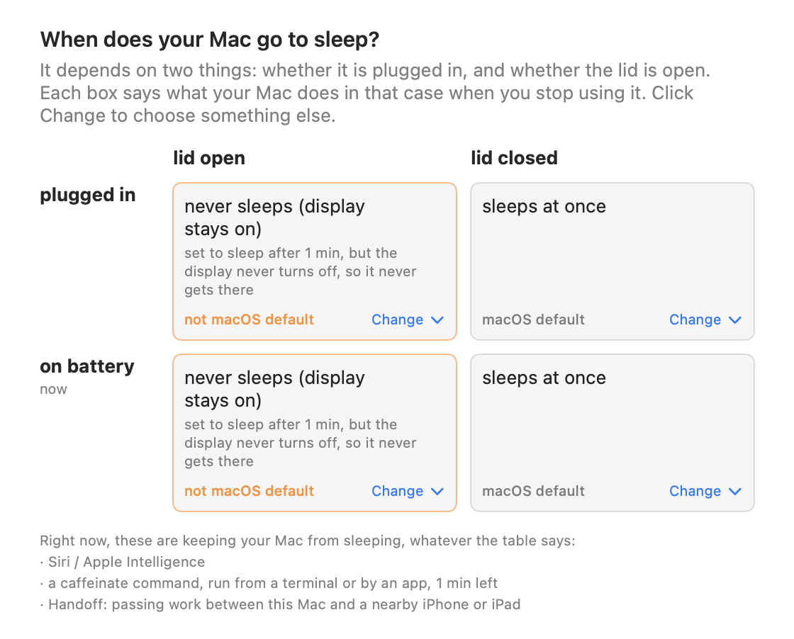

# Lid

Lid lets you choose when your Mac goes to sleep, even with the lid closed. A Mac normally goes to sleep the moment you close it. With Lid, it can keep running a download, a build or a call in your bag, for an hour say, and then sleep.



## Install

Download `Lid.dmg` from the [latest release](https://github.com/cablehead/lid/releases/latest), open it, and drag Lid to Applications. It runs on macOS 14 or later.

Lid lives in the menu bar, as a closed laptop under a sun. The sun is filled while Lid is keeping your Mac awake, or will keep it awake when you close the lid.

## Use

To see when your Mac goes to sleep, click the sun and choose Show Me. Each box covers one case: plugged in or on battery, with the lid open or closed. A box your Mac doesn't have at its usual setting says "not macOS default".

To keep your Mac awake with the lid closed, click Change in a "lid closed" box and pick how long: an hour, say, then it sleeps. Plugged in, it can also stay awake until you open the lid again. The first time, Lid asks for your password once, for the reason under [Password](#password).

To change when your Mac sleeps with the lid open, click Change in a "lid open" box. Lid shows the command it will run, such as `sudo pmset -c sleep 0`, and macOS asks for your password to run it. Lid never sees or keeps your password.

Below the boxes, Lid says what is keeping your Mac awake right now, such as music playing, and when it will sleep if the lid is closed.

To remove Lid, choose Uninstall Lid in the menu. It turns sleep back on, removes the password file, deletes Lid's settings, and moves Lid to the Trash.

## Password

A Mac goes to sleep the moment its lid closes, unless sleep was turned off before that, and only an administrator can turn it off or on. Lid does this when nobody is at the keyboard: when your hour is up and the Mac should sleep in your bag, when it gets hot, or when you unplug it. There is no one there to type a password then. So the first time you choose to stay awake with the lid closed, Lid asks for your password once, and uses it to write `/etc/sudoers.d/lid`:

```
# Written by Lid. Lets you run only these commands as root, without a password.
you ALL = (root) NOPASSWD: /usr/bin/pmset -a disablesleep 0, /usr/bin/pmset -a disablesleep 1, /usr/bin/pmset sleepnow
```

Those commands turn sleep off, turn it back on, and put the Mac to sleep now. Nothing else runs as root without asking. Uninstall Lid removes the file, or you can remove it yourself:

```sh
sudo pmset -a disablesleep 0; sudo rm /etc/sudoers.d/lid
```

## When it sleeps anyway

With the lid closed, Lid puts your Mac to sleep early if it gets hot, or if the battery drops under 15%. A Mac in a bag can get hot, so short times are safer.

If you plug in or unplug with the lid closed, the new case's time takes over, still counted from when you closed the lid.

While Lid is keeping your Mac awake with the lid closed, it doesn't go to sleep when idle with the lid open either. The box says so.

If Lid crashes or is force quit while it has sleep turned off, sleep stays off until Lid starts again, or until you run:

```sh
sudo pmset -a disablesleep 0
```

Try it on a desk first, with a short time, before trusting it in a bag.

## Build

```sh
swift test
swift build -c release
.build/release/Lid
```

`./dmg.sh` builds `.build/dist/Lid.dmg` for Apple silicon and Intel, signed with your Developer ID. With an App Store Connect API key in `ASC_KEY_ID`, `ASC_ISSUER` and `ASC_P8`, it is notarized too, so it opens on other Macs without a warning.

`.build/release/Lid --snapshot DIR` draws the window to PNG files without changing any setting, for checking how it looks.
